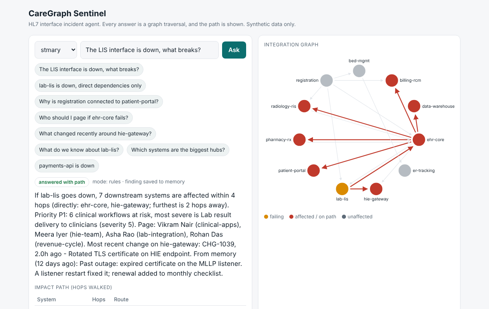

# CareGraph Sentinel

**An incident agent for hospital HL7 integration teams, whose entire context lives in a FalkorDB graph.**

> "The lab interface is down. What breaks, which clinical workflows are hit, who do I page, and what changed?"

In a hospital, systems (registration, EHR, lab, radiology, pharmacy, HIE gateway...) exchange HL7 v2 messages over interface channels. When one channel stops, the real question is never answered by a single record: it depends on *how feeds connect* (lab -> EHR -> pharmacy/billing/portal...). Sentinel stores that network as a graph and answers by walking it, showing the exact path behind every claim.

**Hackathon:** Graph Hacks (WeMakeDevs x FalkorDB), Oct 15-18 2026
**Tracks entered:** Track 1 - Agents That Act on Connected Data, and Track 2 - Agent Memory and Coordination
**Data:** 100% synthetic. No patient, employer or customer data.



## Why the graph is doing the work

Remove FalkorDB and the product stops working:

| Capability | How the graph does it |
|---|---|
| Blast radius | Variable-length traversal `-[:FEEDS*1..4]->`. Depth 1 finds 2 systems for a lab outage; depth 4 finds 7, including ones nobody listed by hand. |
| Why are A and B connected? | `algo.SPpaths` (shortest path), returned as the actual hops and interface channels |
| Which system is the hub? | `algo.pageRank` over the feed network |
| Who to page | Traverse from affected systems to owning team to the person on call *right now* |
| Memory across sessions | Findings are nodes linked to the system they are about, read before every analysis |
| Hospital isolation | One graph per hospital (`caregraph:<tenant>`), not a filter someone can forget |

## Data model

```
(:System {name, kind, criticality})-[:FEEDS {interface, msg, weight}]->(:System)
(:Workflow {name, severity})-[:RELIES_ON]->(:System)
(:Team {name})-[:OWNS]->(:System)
(:Person {name, role})-[:ONCALL_FOR {from, to}]->(:Team)
(:Change {id, at, author, summary})-[:TOUCHED]->(:System)
(:Finding {text, at, session, author})-[:ABOUT]->(:System)      <- agent memory
```

`interface` is the HL7 channel name (e.g. `ORU_LIS_TO_EHR`) and `msg` the HL7 v2 message type (e.g. `ORU^R01`). Two synthetic hospitals are seeded as separate graphs: `stmary` (11 systems) and `riverside` (7 systems, different people, no HIE gateway).

## The queries the product depends on

All live in [`app/tools.py`](app/tools.py). Each is human-written and parameterised.

**Blast radius (multi-hop traversal)**
```cypher
MATCH path = (s:System {name: $name})-[:FEEDS*1..4]->(d:System)
RETURN d.name AS system, d.criticality AS crit, length(path) AS hops,
       [n IN nodes(path) | n.name] AS via,
       [r IN relationships(path) | r.interface] AS ifaces
ORDER BY hops, system
```
Feeds are cyclic (orders go out, results come back), so the tool drops self-loops and revisits and keeps the shortest route per system.

**Clinical workflows at risk**
```cypher
MATCH (w:Workflow)-[:RELIES_ON]->(s:System) WHERE s.name IN $names
RETURN w.name, w.severity, collect(s.name) ORDER BY w.severity DESC
```

**Who to page (on call right now)**
```cypher
MATCH (t:Team)-[:OWNS]->(s:System) WHERE s.name IN $names
OPTIONAL MATCH (p:Person)-[o:ONCALL_FOR]->(t) WHERE o.from <= $now AND o.to >= $now
RETURN t.name, p.name, p.role, collect(DISTINCT s.name)
```

**Recent changes around the blast radius**
```cypher
MATCH (c:Change)-[:TOUCHED]->(s:System) WHERE s.name IN $names AND c.at >= $since
RETURN c.id, c.summary, c.author, c.at, s.name ORDER BY c.at DESC
```

**Why are two systems connected? (graph algorithm)**
```cypher
MATCH (a:System {name: $a}), (b:System {name: $b})
CALL algo.SPpaths({sourceNode: a, targetNode: b, relTypes: ['FEEDS'],
                   relDirection: 'outgoing', weightProp: 'weight', pathCount: 1})
YIELD path, pathWeight
RETURN [n IN nodes(path) | n.name], [r IN relationships(path) | r.interface], pathWeight
```

**Hub systems (graph algorithm)**
```cypher
CALL algo.pageRank('System', 'FEEDS') YIELD node, score
RETURN node.name, node.kind, score ORDER BY score DESC LIMIT $limit
```

**Memory: read before reasoning, write the conclusion back**
```cypher
MATCH (f:Finding)-[:ABOUT]->(s:System {name: $name}) RETURN f.text, f.at, f.session ORDER BY f.at DESC LIMIT 5

MATCH (s:System {name: $name})
MERGE (f:Finding {text: $text, day: $day}) ON CREATE SET f.at = $at, f.session = $session, f.author = 'sentinel'
MERGE (f)-[:ABOUT]->(s)
```

## How the agent behaves

```
question -> choose tools -> validate args against the graph -> run Cypher -> compose answer from rows
         -> wording guard -> write finding back to memory
```

* **The model never writes Cypher.** It picks from a fixed catalogue of 8 tools (also exposed over MCP in [`mcp_server.py`](mcp_server.py)). Arguments are typed, clamped (depth <= 4, etc.), and system names are resolved *against the graph* before anything runs, so injection and hallucinated names are closed off.
* **It never bluffs.** Every answer has one of five outcomes: `answered_with_path`, `answered_from_memory`, `not_in_graph`, `unknown_system`, `need_system`. An empty traversal says "not modelled", which is deliberately *not* "safe". An unknown system name runs no query at all.
* **Wording guard.** Any hyphenated name in the final sentence must be a known system or appear in the returned rows; otherwise the LLM text is rejected and a template built from the rows is used instead.
* **Works with or without an LLM.** With `ANTHROPIC_API_KEY` set, the model selects tools and phrases the summary. Without it, a deterministic rule router and templates produce the same structured results.
* **Every answer shows its trace**: tool, arguments, milliseconds, rows returned.

## Run it

**Docker (recommended)**
```bash
docker compose up --build
# app:               http://localhost:8000
# FalkorDB Browser:  http://localhost:3000   (inspect the graph visually)
```
The app seeds both hospitals on first boot.

**Local Python + FalkorDB container**
```bash
docker run --rm -p 6379:6379 -p 3000:3000 falkordb/falkordb:latest
pip install -r requirements.txt
python -m app.seed            # add --reset to rebuild (wipes memory)
uvicorn app.api:api --reload  # http://localhost:8000
```

**FalkorDB Cloud:** set `FALKORDB_HOST`, `FALKORDB_PORT`, `FALKORDB_USERNAME`, `FALKORDB_PASSWORD`, `FALKORDB_SSL=1` (see `.env.example`). No code changes.

**Optional LLM:** `export ANTHROPIC_API_KEY=...` (model via `CLAUDE_MODEL`).

**MCP:** `python mcp_server.py` (stdio) and register it in any MCP client.

**Tests** (embedded FalkorDB, no Docker needed; set `FALKORDB_HOST` to test against a container):
```bash
pip install -r requirements-dev.txt
pytest -q          # 18 tests
```

## Try these

| Ask | Shows |
|---|---|
| The LIS interface is down, what breaks? | multi-hop impact, workflows, on-call, changes, memory |
| lab-lis is down, direct dependencies only | depth 1 (2 systems) vs depth 4 (7 systems) |
| Why is registration connected to patient-portal? | shortest-path algorithm |
| payments-api is down | `unknown_system`: no query runs, nothing guessed |
| What do we know about lab-lis? | `answered_from_memory` |
| Switch hospital to `riverside`, ask about hie-gateway | tenant isolation |

## AI-use disclosure

Built with Claude as a coding assistant (design discussion and code generation). The author reviewed the design, can explain the graph model, every query and the architecture, and the test suite runs against a real FalkorDB engine.

## Credits and limitations

* The "fixed tool catalogue + validate names against the graph + return the path" pattern follows the organisers' tutorial, *How to Build an Agent That Reasons Over a Graph*. The domain, data model, HL7 clinical-workflow layer, tenant isolation, memory design and guard here are this project's own.
* Synthetic data only. This is a decision-support demo, not a clinical or production monitoring system.
* The graph is a model of dependencies: if a feed is not recorded, the agent will say "not in the graph", not "safe".
